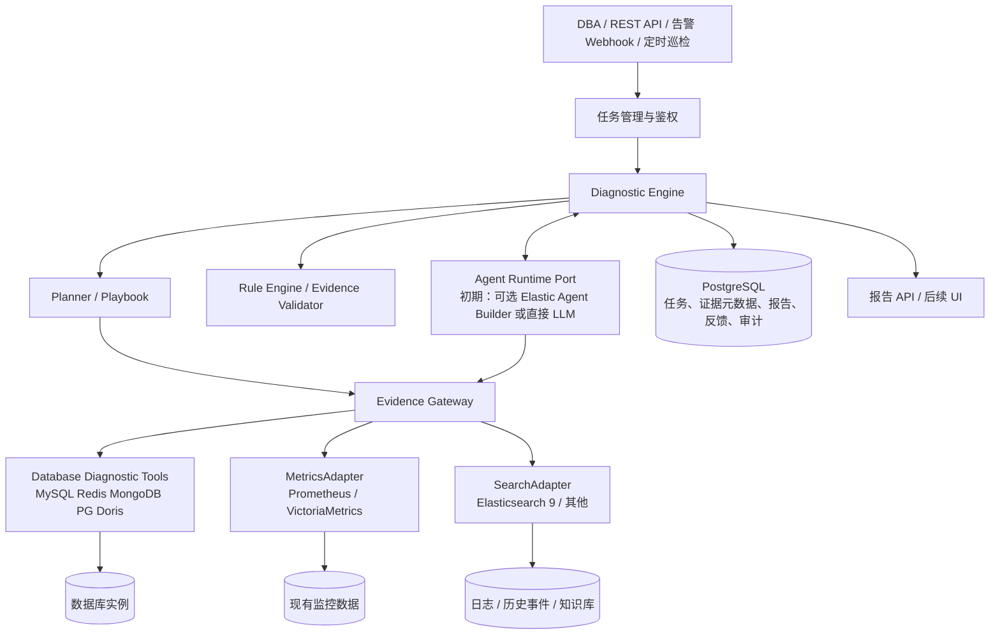

# Database AI Center（DBIC）架构与产品设计文档

> 版本：V2.1 / 2026-10-31  
> 状态：供 Codex 实现的基线设计。设计决策、API Schema 和验收标准变更须更新本文及实现文档。  
> 目标数据库：MySQL、Redis、MongoDB、PostgreSQL、Apache Doris。  
> 首个可交付版本：MySQL 锁等待 / 慢 SQL 诊断闭环；第二阶段 Redis 内存异常。

## 1. 产品定义

DBIC 是**数据库智能故障调查与诊断决策系统**，不是新的监控系统、日志平台、通用 DBA 控制台或自动修复平台。系统接受人工问题、告警或巡检任务，选择专业诊断 Playbook，通过只读工具获取证据，用确定性规则校验、LLM 辅助解释，输出可追踪的调查报告，接受 DBA 反馈并持续积累确认过的案例。

### 1.1 用户故事

- DBA 选择实例 `mysql-lab-01`，发起“当前是否有锁等待”，返回阻塞链、会话、证据与建议；无锁等待时明确报告当前状态，不能断言过去从未发生。
- DBA 发起“最近 30 分钟慢 SQL 为什么增多”，系统比较历史慢查询摘要及指标，在数据缺失时标明限制。
- Redis 内存告警到达，系统从监控获取趋势、读取内存构成、调用已授权的大 Key 审计摘要，输出假设和下一步验证步骤。
- DBA 查看诊断步骤、证据来源、工具调用及最终确认的根因，能够将报告标注为“正确/部分正确/错误”。

### 1.2 范围边界

**纳入：** 实例解析、任务管理、只读诊断工具、指标与日志查询适配、Playbook、规则、证据规范化、LLM 可选解释、报告、审计、案例回放、故障反馈。

**不纳入首版：** 自建 Exporter、代替 Prometheus / VictoriaMetrics、代替 Elastic 日志采集、跨 TKE/GitLab 根因分析、生产 DDL/重启/kill session/FLUSHALL、自动修复、多 Agent 自治协商、独立重型 Web 控制台。

### 1.3 设计原则

1. **核心无 ES 依赖**：核心业务层不 import Elasticsearch 客户端/ES|QL；只依赖 `EvidenceSearchPort`。
2. **确定性优先**：Playbook 和规则先建立可信的检查路径；LLM 不负责权限、执行安全和数值计算。
3. **最小生产权限**：工具级白名单、实例 allowlist、超时、并发限制、结果截断、脱敏、审计；不暴露 `execute_sql` 等任意命令工具。
4. **事实/推导/假设分离**：诊断结论必须指向证据 ID，不能把时间相关性当成已确认根因。
5. **可退化**：Elastic、LLM 或 Prometheus 不可用时，能完成纯实时只读诊断，报告标明缺失证据。
6. **模块化单体起步**：FastAPI + worker（初期可同进程）+ PostgreSQL；避免过早微服务化。
7. **数据库差异显式建模**：插件接口统一结果格式，不要求五类数据库具备相同的语义与诊断命令。

## 2. 总体架构



**两条独立路径：**

- 持续观测：数据库 → exporter / 云监控 → Prometheus/VM；数据库日志 → 现有日志采集器 → Elastic/Loki。DBIC **不承接日常指标写入链路**。
- 主动调查：任务 → Engine → Evidence Gateway → 查询指标/搜索日志/按需数据库只读探测 → 规则与证据校验 → 报告归档。仅在确有需求时通过可选 Snapshot Collector 保存低频或告警触发的诊断快照。

## 3. 逻辑模块与职责

| 模块 | 输入 | 输出 | 边界与备注 |
|---|---|---|---|
| Asset Registry | instance_id、调用者身份 | 类型、版本、环境、连接配置引用 | 首版 YAML；后续 CMDB Adapter；不得向 LLM 暴露凭据 |
| Trigger & Task Manager | API、Webhook、巡检触发 | task_id、生命周期状态 | 幂等、限流、权限校验、重试 |
| Diagnostic Planner | 实例类型、问题、能力清单 | playbook_id、诊断步骤 | 首版确定性路由；复杂场景可由 LLM 建议但须白名单验证 |
| Database Diagnostic Tools | 受控诊断请求 | 结构化当前状态 | 不负责持续采集指标/日志；不允许任意 SQL/Redis 命令 |
| Evidence Gateway | 统一查询请求 | `Evidence` | 查询 Metric/Search/Database Port；时间和单位规范化；记录缺失与错误 |
| Rule Engine | Evidence、适用规则 | Findings、状态 | 与 LLM 解耦，可单测，可重放 |
| Agent Runtime | 只读工具清单、任务上下文 | 额外调查建议与解释 | 可替换；不能绕过 Planner/Policy |
| Knowledge | 故障报告、手册、相似查询 | 历史案例 | 可选 Elastic 混合检索；PostgreSQL 保存系统记录主数据 |
| Report & Evaluation | Findings、Evidence、反馈 | 报告、质量指标 | 每条重要结论标注依据；人工确认单独存储 |

### 3.1 模块边界特别约定

- `Database Diagnostic Tools` **不写 Prometheus**。只有确需增加自定义指标时，经单独 Exporter 或 collector 暴露 Prometheus `/metrics`，不得混进实时诊断 API。
- `Evidence Gateway` 负责读取不同来源数据，不将查询语句泄漏给 Agent。外部工具默认返回结构化数据、有限长度摘要及 evidence_id。
- `Diagnostic Engine` 是唯一的任务状态和调查顺序所有者。Elastic Agent Builder 仅作为可选 Runtime；如果启用，核心 Playbook、规则、权限仍保存在代码仓库。
- 任务、反馈、权限、审计的持久化主数据在 PostgreSQL；ES 可保存检索副本，不作为系统的唯一事实来源。

## 4. 数据库插件能力矩阵

| 类型 | 首批工具 | 下一阶段 | 风险约束 |
|---|---|---|---|
| MySQL | health、lock_chain、slow_query_summary、replication_health | explain_plan、buffer_pool | EXPLAIN 需计划检查与 SQL 来源白名单；禁用 EXPLAIN ANALYZE 默认路径 |
| Redis | memory_breakdown、slowlog_summary、cluster_health、bigkey_audit_read | keyspace_sampling | SCAN 有预算；禁止 KEYS、MONITOR、FLUSH* 等危险操作 |
| MongoDB | server_health、current_ops_summary、replica_health | profiler_digest、index_usage | 按角色/版本检查权限；不执行昂贵的任意 explain |
| PostgreSQL | blocking_sessions、long_transactions、replication_slots | pg_stat_statements、vacuum_health | 限定 pg_catalog/pg_stat 的预设查询，避免任意长事务 |
| Doris | fe_be_health、query_profile_summary、compaction_health | load_failures、tablet_health | 版本相关接口适配；Profile 有大小与耗时限制 |

**首版必须实装 MySQL `health`、`lock_chain`、`slow_query_summary`，其余均保留接口与 stub 并返回 `not_implemented`，不能伪造数据。**

## 5. 核心数据契约

所有时间使用 UTC ISO-8601；数值带单位；实例 ID 不能混用服务名；查询应有时区和时间上下文。

### 5.1 DiagnosticTask

```json
{
  "task_id": "uuid",
  "requested_by": "local-user",
  "database_type": "mysql",
  "instance_id": "mysql-lab-01",
  "problem_type": "lock_wait",
  "window": {"start": "2026-10-31T00:00:00Z", "end": "2026-10-31T00:30:00Z"},
  "status": "queued",
  "playbook_id": "mysql.lock_wait",
  "created_at": "2026-10-31T00:31:00Z"
}
```

状态机：`queued -> running -> completed | partial | failed | cancelled`；不可从终态重入，重新执行创建新任务并记录 `parent_task_id`。

### 5.2 Evidence

```json
{
  "evidence_id": "uuid",
  "task_id": "uuid",
  "kind": "database_state",
  "source": "mysql.get_lock_chain",
  "instance_id": "mysql-lab-01",
  "observed_at": "2026-10-31T00:31:10Z",
  "collected_at": "2026-10-31T00:31:11Z",
  "window": null,
  "quality": "observed",
  "status": "ok",
  "payload": {"blocking_session": 101, "waiting_sessions": [202, 203]},
  "limitations": [],
  "redacted": true
}
```

`kind`：`metric | log | database_state | historical_incident | derived`。`quality`：`observed | derived | inferred`。`status`：`ok | empty | unavailable | timeout | forbidden | error`。记录工具版本和参数的安全摘要，必要时记录 payload hash；不要存密码/完整敏感 SQL/用户数据。

### 5.3 Finding / Report

```json
{
  "finding_id": "uuid",
  "statement": "会话 101 正在阻塞会话 202、203",
  "certainty": "observed",
  "evidence_ids": ["ev-lock-1"],
  "rule_id": "mysql.lock_wait.blocker_identified"
}
```

`certainty`：`observed | supported_hypothesis | unverified_hypothesis | confirmed_root_cause`。其中 `confirmed_root_cause` 仅在确定性验证条件满足并经规则或人工确认时使用，LLM 无权自行升级。报告分为：摘要、调查时间线、事实、假设、缺失证据、建议、风险、工具清单、反馈。

## 6. Playbook 与规则

### 6.1 Playbook 示例

```yaml
id: mysql.lock_wait
version: 1
database_types: [mysql]
triggers: [manual, alert]
required_tools:
  - mysql.health
  - mysql.lock_chain
optional_tools:
  - metrics.mysql_connections
  - search.mysql_errors
limits:
  max_tool_calls: 8
  max_duration_seconds: 90
  allow_mutation: false
```

`mysql.high_cpu`、`mysql.slow_query`、`redis.memory_growth` 后续增补。工具 ID 是稳定契约，调用前检查目标实例是否支持。

### 6.2 规则执行

先检查证据有效性、采样时间、版本兼容，再执行确定性规则。规则输出 `passed | failed | inconclusive` 和关联 evidence_ids；任何数据缺失不得自动标为正常。LLM 只对规则与证据做解释和可选的下一步调查提议。

## 7. 安全与多环境治理

1. 本地首版实例清单 `configs/instances.yaml` 仅保留连接引用，例如 `env:MYSQL_LAB_DSN`，凭据存 `.env`（gitignore）/ secrets；日志中隐藏 DSN。
2. 明确 `lab` / `staging` / `production`，首版默认**仅 lab 连接允许**。生产支持需单独审核权限设计。
3. 不提供任意 SQL/命令执行 API。工具内置参数化、只读预定义查询；账户仅最小必要权限；设置数据库侧只读/超时/结果限制。
4. `max_tool_calls`、`max_duration_seconds`、每实例并发、返回字节数上限；当数据库异常时可快速熔断。
5. Webhook 认证与幂等键；任务创建和结果读取鉴权。容器只在 localhost 监听，除非用户显式开启访问网关。
6. 记录谁在何时检查了哪个实例、使用哪个工具、成功/失败、耗时；敏感查询文本按规则脱敏。
7. 不把生产数据库数据、SQL 参数、凭据未经审查直接发送给外部 LLM。

## 8. 系统接口（逻辑契约）

- `POST /api/v1/diagnoses`：创建任务，body: `instance_id`、`problem_type`、可选 `window`；返回 `202 {task_id,status}`。
- `GET /api/v1/diagnoses/{task_id}`：查询任务、步骤、报告概要。
- `GET /api/v1/diagnoses/{task_id}/evidence`：查看已脱敏证据与引用。
- `POST /api/v1/diagnoses/{task_id}/feedback`：DBA 标注准确性、已确认根因、备注。
- `GET /api/v1/capabilities`：列出数据库/诊断类型/工具支持情况。
- `GET /healthz` / `GET /readyz`：应用健康、依赖可用性。
- 内部 MCP：暴露语义化只读工具，不接受任意 SQL。

响应错误统一：`code`、`message`、`retryable`、`details`（脱敏）；请求/任务关联 `request_id`。

## 9. 非功能要求和验收

- 首版以**单用户、单机、可重放**为目标；没有生产 HA 承诺。
- 任意失败均保留任务状态，不应产生无证据的“诊断成功”。
- 首版验收：模拟 MySQL 锁等待至少 3 个用例（有阻塞/无阻塞/权限不足），慢 SQL 至少 2 个用例（存在/数据缺失）；所有报告证据 ID 可以回溯；无任何写操作；可在没有 Elastic、没有 LLM 时完成基本规则调查。
- 可迁移性：使用内存 FakeSearch Adapter 完成测试，并至少用一个真实非 ES 搜索实现完成契约测试（可放第二阶段）。
- 质量目标作为后续回放评估指标，不能在无真实样本时宣称“80% 根因准确率”。

## 10. ADR（架构决策记录）

- **ADR-001**：核心是 Diagnostic Engine，不是采集平台。原因：复用现有监控/日志，避免重复建设。
- **ADR-002**：Elastic 9 是可选 SearchAdapter，不是全系统必需依赖。原因：授权、成本与迁移能力。
- **ADR-003**：Agent Runtime 可替换；Playbook、证据模型、规则必须代码化。原因：防止 Agent Builder 锁定业务流程。
- **ADR-004**：PostgreSQL 保存任务、反馈及审计主数据。原因：事务性及平台独立性。
- **ADR-005**：先采用模块化单体而非微服务。原因：降低开发和调试复杂度。
- **ADR-006**：默认只读且仅 lab；修复操作与诊断隔离。原因：生产数据库安全。

## 11. 未来扩展（非首版）

- Redis 大 Key 审计导入、PostgreSQL Vacuum/WAL、MongoDB WiredTiger、Doris Profile/Compaction。
- 告警自动触发 + Snapshot Collector（有限预算、保留策略），查询优化建议与差异比较。
- 相似故障 RAG、知识检索、人工反馈驱动的回放评测。
- CMDB、云数据库 API、团队权限、独立 UI、经审批的确定性 Runbook（与只读诊断服务严格分离）。

## 12. M0 契约落地说明

- M0 仅开放 healthz、readyz、capabilities；后者使用本地单用户 Bearer Token。
  OpenAPI 查询同样鉴权。响应包含服务端生成的 X-Request-ID，错误体包含 request_id。
- capabilities 返回 milestone: M0 与 databases 列表，各项包含 database_type、
  status: not_implemented、空 tools；不宣称尚未实现的诊断能力可用。
- Finding 增加可选 confirmed_by（rule/human），确认根因时必填。此字段只表达确认来源，
  后续 Engine 必须验证来源权限，不接受 Agent 自行升级。
- Report 用 findings.certainty 区分事实/假设，增加 status（observed/inconclusive/unavailable）
  与 evidence_ids；结论引用必须存在于报告证据清单。M1 还须验证证据归属及实际存在。
- M0 生命周期在 core 纯函数中转换；已提供数据库迁移，事务存储和执行调度留到 M1。

## 13. M1 契约落地说明

M1 已实现 MySQL 三个工具、诊断创建/读取/证据/反馈端点，capabilities.milestone 为 M1。
Task 增加 request_id；创建请求可传 parent_task_id，限定为同实例同问题的终态任务。
TaskDetail 返回 task、steps、report、feedback；反馈 verdict 为 correct/partial/incorrect。
NullAgent 不升级 confirmed_root_cause；人工确认只进入 feedback，保留原报告。
TaskStore 的完成操作接收由 Engine 转换的终态 Task，事务校验同任务证据并归档报告。
历史 window 不映射为实时采样窗口，缺失历史数据时 partial；累计语句摘要不等同于慢日志。
具体实现限制与真实验收入口见 [m1-validation.md](m1-validation.md)。

## 14. M2 契约落地说明

capabilities.milestone 为 M2，新增 historical_backends（metrics: null/prometheus、search: null/elastic）。
它表示配置选择，不表示连通性。HTTPX 属于适配器依赖，core 保持只依赖标准库和 Pydantic。
Port 方法签名不变；ToolResult 增加 kind/window，默认 database_state/None 兼容实时工具。
历史证据沿用已有 JSON 存储，不增加数据库迁移，readyz 仍检查 0002_m1。

创建任务的可选 window 必须有时区、跨度不超过 24 小时、结束不在未来（容许 5 秒时钟误差）。
所有时间归一为 UTC。无窗口保持两个实时步骤；有窗口追加一个固定指标和一次事件检索。
锁等待读取连接数、error/deadlock 事件；慢查询读取慢查询计数器 rate[5m]、error/slow_query 事件。
原始累计 MySQL 摘要仍不对应历史窗口。历史事实只能说明返回的记录，不能升级根因。
时间线按 observed_at 排序；实时证据 window 为 None，避免把现在的状态伪装成过去的状态。

Prometheus 标签值需显式映射到 mysql-lab-01；最多一条序列、301 点，数值/单位/时间网格校验。
ES 固定检索 db-events-lab，只读、最多 50 条事件，拒绝部分分片/超界或错实例结果。
不返回原始 message、SQL、PromQL、DSL。empty 表示检索无匹配项，不表示目标历史正常。
禁用/断连/权限不足/超时均输出结构化状态及 limitations，任务 partial，保留实时结论。
请求总超时 5 秒、响应上限 256 KiB，证据持久化上限沿用 64 KiB；不新增重试和采集器。

配置及验收范围见 [m2-validation.md](m2-validation.md)。

## 15. M3 契约落地说明

capabilities.milestone 为 M3，新增 agent_backend（null/openai_compatible）与 mcp_enabled。
M1/M2 REST 创建请求不变；Report 增加默认值为 disabled 的 agent_status、可选 agent_reason、
agent_suggestions。旧报告可继续读取，无新数据库迁移。AgentRuntimePort.explain 签名不变。

模型只获得本任务已脱敏证据的 ID、来源、kind/status 与是否有限制；不发送 payload、
SQL、日志原文、用户反馈、DSN、请求者身份或自由文本。模型通过单次 propose_checks 函数调用
返回最多三个结构化建议：tool_id、instance_id、reason、evidence_ids。reason 是枚举，
不直接显示模型自由文本。核心再次验证报告事实未被改写、引用归属和 Policy 白名单，
已有调用数与建议数合计不得超过八次；重复工具建议也拒绝。不执行这些建议，人工可另行发起检查。
模型超时/不可用/无效输出时保留规则报告；agent_status 记录 unavailable/rejected，
不因可选 Agent 故障将已有有效数据库调查改为 failed。禁止 Agent 升级 confirmed_root_cause。

MCP 使用官方 Python SDK 2.3.0，以同一应用的 `/mcp/` 提供 Streamable HTTP。
默认关闭，开启后所有方法均使用已有单用户 Bearer Token，限制 loopback Host/Origin、
16 KiB 请求体，复用 16 个待执行任务容量、单实例并发 1、任务预算 8 次/90 秒。
仅暴露 mysql_health/mysql_lock_chain/mysql_slow_query_summary，参数只有 mysql-lab-01。
额外 SQL/DSN 参数被拒绝。每次合法调用创建 `tool:<tool_id>` 内部任务，通过同一 TaskRunner
执行一个固定工具并归档 evidence/step/report/audit；调用者记录为 mcp-local-user。
返回单份脱敏 Evidence，可通过 REST 按 task_id 回读；MCP 工具不会再调用 LLM。
此单用户 Token 边界不等同于公网 OAuth 服务，不支持远程无鉴权访问。

Agent HTTP 请求最多 8 秒、32 KiB 响应，无重试/重定向/环境代理；公网模型端点必须 HTTPS，
loopback/host.docker.internal 允许 HTTP 便于 lab 模型测试。默认不发送任何外部请求。
保留进程内队列限制，无独立 Worker，不宣称持久调度。M4/M5 未实现。
